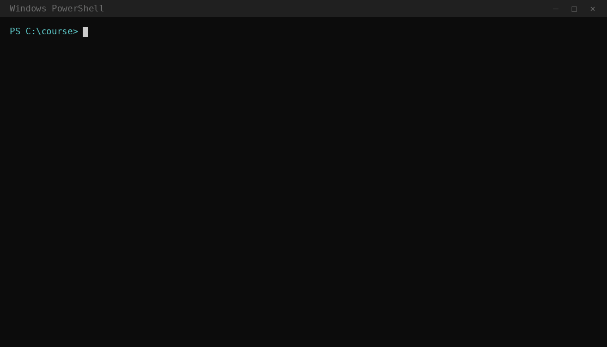

# pptx-vo-elevenlabs

ElevenLabs voiceover inside PowerPoint decks, slide by slide, with a single command.

Write the text to read in a slide comment (or in the speaker notes) that starts with `VO:`.
The script generates the audio with ElevenLabs and embeds it in the `.pptx`. During the slideshow
the voice plays on its own, on-click animations are synced with the speech and the slide advances
when the audio ends. The file stays a normal PowerPoint deck: open it, present it, send it to
anyone, or export it as a video from PowerPoint.



<sub>A real run of <code>vo.py</code>; the ElevenLabs responses (voice, credits, audio) are simulated.
Regenerate it with <code>tools/record_demo.py</code>.</sub>

## Why

- **The script lives in the slide.** No separate files to keep in sync: edit the comment and run again.
- **No surprise spending.** It shows the texts and the credits needed first, checks the credits
  you have left and asks for confirmation.
- **Pay only for changes.** Audio is cached: on a re-run, only slides whose text changed are
  regenerated.
- **Safe to re-run.** Audio is replaced, not duplicated, and the original file is never touched:
  the output is `<name>_vo.pptx`.
- **Readable errors.** Every error says what happened and how to fix it. Network errors, 429 and
  5xx are retried; if one slide fails, the others go ahead.

## Requirements

- Python 3.9 or later
- [ffmpeg](https://ffmpeg.org/) on the PATH (`winget install ffmpeg` · `brew install ffmpeg` · `sudo apt install ffmpeg`)
- An [ElevenLabs](https://elevenlabs.io) account with an API key

## Installation

```bash
git clone https://github.com/<user>/pptx-vo-elevenlabs.git
cd pptx-vo-elevenlabs
pip install -r requirements.txt
```

## Configuration

Copy `.env.example` to `.env` and fill in the key and the voice:

```ini
ELEVENLABS_API_KEY=your-key
ELEVENLABS_VOICE_ID=voice-id
```

- **API key:** [elevenlabs.io/app/api/api-keys](https://elevenlabs.io/app/api/api-keys). The
  *Text to Speech* permission is enough. With *User: Read* and *Voices: Read* as well, the script
  can check credits and voice before starting.
- **Voice ID:** `python vo.py --voices` lists the voices in your account with their IDs.

Environment variables work too (`$env:ELEVENLABS_API_KEY="..."` in PowerShell,
`export ELEVENLABS_API_KEY=...` in bash). Then check that everything is in place:

```bash
python vo.py --check
```

## Writing the voiceover in the slides

**In comments** (Review › New Comment):

```
VO: Welcome. In this lesson we will set up a monthly budget in three simple steps.
```

Only comments that start with `VO:` are read. Review comments and replies are ignored. Several
`VO:` comments on the same slide are read in order.

**In the speaker notes**, used only if the slide has no `VO:` comments:

```
Notes for the presenter: this line is not read.
VO: (minute 0) "Step one is knowing your income." (calm tone)
VO: (click 1) "Start from your take-home pay, not your gross salary."
VO: (click 2) "Then add any occasional income."
```

| Syntax | Effect |
|---|---|
| `VO: text` | Line to read |
| `(directions)` | Text in parentheses is not read, and neither are the outer quotes |
| `(click N)` | The line starts together with the slide's N-th animation click |
| `[pause: 0.8]` | Pause inside the text, in seconds (max 3) |

Slides without `VO:` stay on screen in silence for 4 seconds (`--silent-slide`).

The voiceover can be in any language supported by the chosen ElevenLabs model
(`eleven_multilingual_v2` by default).

## Usage

```bash
python vo.py course.pptx                    # generate and embed the audio
python vo.py course.pptx --preview          # texts and credits, spends nothing
python vo.py *.pptx -y                      # every deck in the folder, no confirmation
python vo.py course.pptx --slides 2,5-7     # only some slides
python vo.py course.pptx --manual --open    # advance on click, then open the result
python vo.py course.pptx --fake             # fake audio: test the structure without credits
python vo.py course.pptx --verify --verify-language it   # check every clip with whisper
python vo.py course.pptx --import notes.txt # write a dictated transcript into the notes
```

`python vo.py --help` lists every option: voice and model, speed and stability, pauses, cache,
diagnostics.

### Animations

With auto-advance, on-click animations become automatic and start together with the matching
`VO:` line:

1. lines tagged `(click N)`: click N starts when that line starts;
2. no tags: the last N clicks go on the last N lines;
3. otherwise: spread evenly over the duration of the voice.

With `--manual`, animations stay on click and slides advance on click only. The audio still
plays automatically.

## Dictating the script

If you would rather speak than type, you can dictate the voiceover and import it into the deck.
`--import` reads a transcript and writes it into the speaker notes as `VO:` lines, one block per
slide:

```bash
python vo.py course.pptx --import trascrizione.txt   # writes the notes, then exits
python vo.py course.pptx --preview                   # after reviewing the text in PowerPoint
python vo.py course.pptx
```

It works out of the box with the output of
[voice-2-notes](https://github.com/elbae/voice-2-notes), a tray app that records the microphone and
transcribes it offline. Say *"nuovo blocco"* when you move to the next slide: voice-2-notes writes
a `---` line there, and `--import` puts each block on its own slide. Timestamps are removed, and
the notes and tasks you dictate (*"nota: …"*, *"task: …"*) are kept in the speaker notes as author
notes that are never read aloud.

Any text file works too, as long as the slides are separated by `---` lines:

```
Welcome. In this lesson we will set up a monthly budget.
---
Step one is knowing your income.
```

Blocks go to the slides in order, skipping hidden slides; `--slides 2-6` picks the target slides
instead. The deck is changed in place, so a backup is saved first (`course.bak-<date>-<time>.pptx`).
Existing `VO:` lines in the notes are replaced, everything else in the notes is kept. Always review
the imported text before generating: speech recognition gets technical terms wrong, and the
synthetic voice would read every mistake.

## Checking the audio

`--verify` transcribes every clip with [faster-whisper](https://github.com/SYSTRAN/faster-whisper),
locally, and compares it word by word with the `VO:` text. Slides below 85% match are flagged with
the words that differ, so you know which ones to listen to before you deliver:

```
  [100%] slide 4: done (9.9 s, check 72% !)
   - slide 4: the audio matches the text at 72%: "phishing" heard as "fishing"; missing "the link"
   - audio check: 4 of 5 slides match the text, 1 to listen to (see above)
```

It needs `pip install faster-whisper`; the model is downloaded on first use (`small`, about 500 MB,
by default; `--verify-model medium` is more accurate and slower). Set `--verify-language` for short
clips, where automatic language detection is unreliable. The check also runs on cached audio, so
`python vo.py course.pptx --verify` on a deck you already generated costs no credits.

A low score is a reason to listen, not proof of an error: numbers written as digits ("3") and
heard as words ("three"), names and acronyms often lower the score on audio that is fine.

## How it works

A `.pptx` is a ZIP of XML files. For each slide the script:

1. reads comments (Microsoft 365 modern comments and legacy ones) and notes with
   [python-pptx](https://python-pptx.readthedocs.io/);
2. sends the text to the [ElevenLabs text-to-speech API](https://elevenlabs.io/docs/api-reference/text-to-speech/convert),
   along with the text of the previous and next slide for continuous intonation;
3. uses ffmpeg to trim silence and normalize loudness to −16 LUFS, so every slide sounds the same;
4. adds the MP3 as slide media and writes the autoplay into `<p:timing>`. The speaker icon sits
   outside the visible area;
5. sets the auto-advance in `<p:transition advTm>` to the end of the audio.

The shapes it creates are named `VO-auto …`: that is how the script finds and replaces them on a
re-run.

## Costs and privacy

- ElevenLabs charges about 1 credit per character. `--preview` tells you how many you need.
- The `VO:` text is sent to ElevenLabs servers. Before using it on confidential content, check the
  [terms of use](https://elevenlabs.io/terms-of-use) and your plan's data retention settings.
- The free plan has few credits and, at the time of writing, no commercial use.
- For content published in the EU, consider the transparency obligations for synthetic content
  in the AI Act (Article 50).

## Known limitations

- Always re-run on the **original deck**, not on the `_vo.pptx`. Animations already made automatic
  by a previous run are not recalculated.
- `.ppt` files must be saved as `.pptx` first.
- The moment each `VO:` line starts is estimated: in proportion to its characters, then snapped
  to the real pauses in the audio. On very short lines it can be off by a few tenths of a second.
- Check the result in PowerPoint: the OOXML validator does not guarantee that every PowerPoint
  version plays it the same way.

## Tests

The tests use a local fake ElevenLabs server and spend no credits:

```bash
pip install -r requirements-dev.txt
pytest
```

They cover reading comments and notes, embedding, cache, re-runs, animation sync, manual mode,
transcript import, the audio check and the error cases: credits exhausted, 429, 5xx, invalid key,
unknown voice, locked or broken files. The audio check runs against a stand-in for faster-whisper,
so the tests need no model download.

The demo GIF is regenerated with `python tools/record_demo.py` (Linux or macOS, also needs
`pip install pyte Pillow`). It uses the same fake server.

## License

[MIT](LICENSE)
